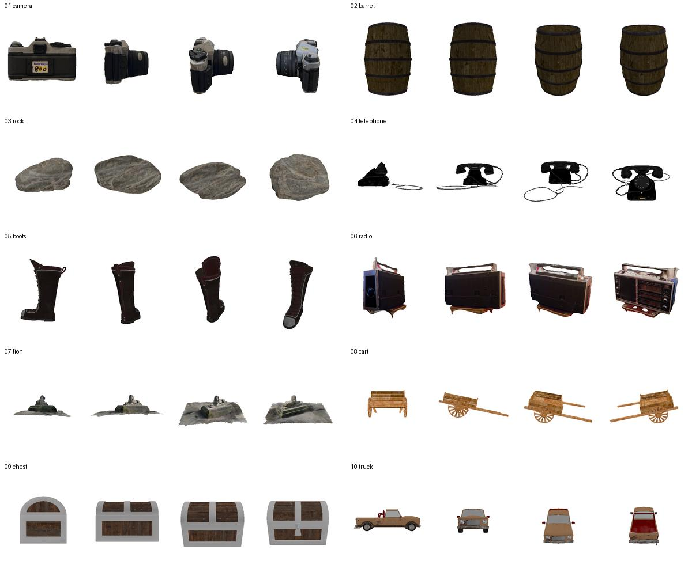
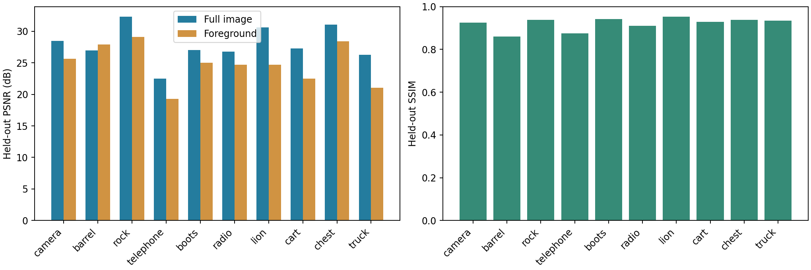
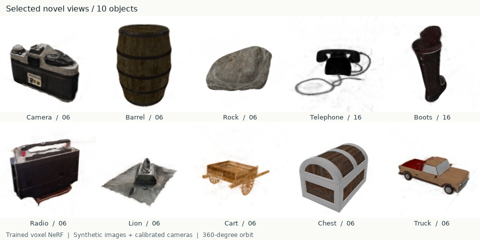
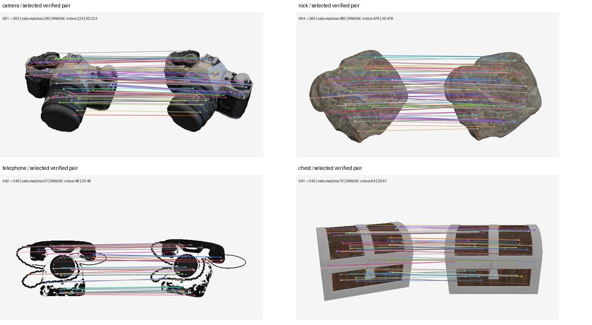
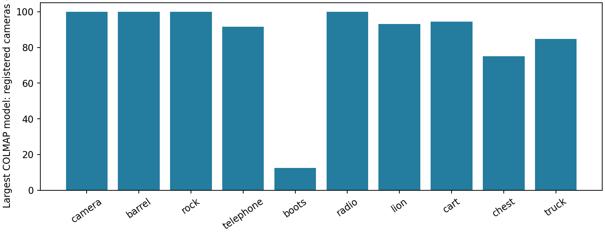
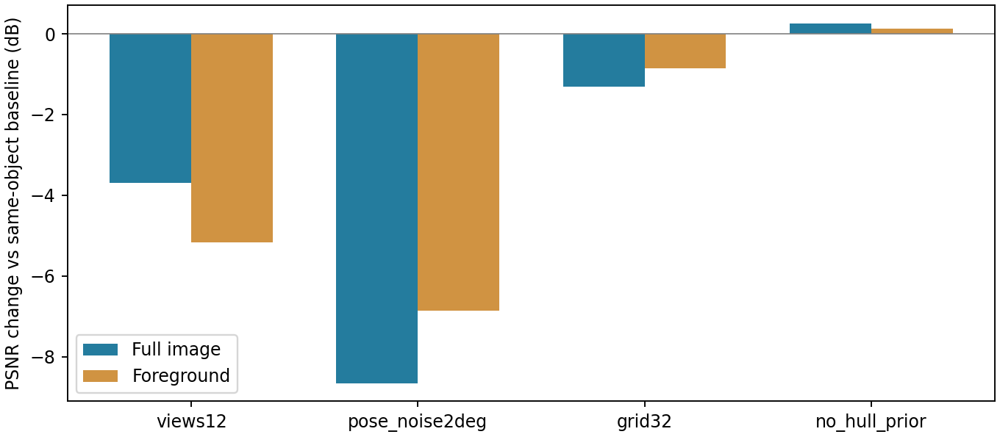

# 第二次作业：从清洗数据到 NeRF 三维重建与渲染

实验日期：2026-11-05；文档更新：2026-11-20。数据范围：第一次作业 Objaverse `000-000`；10个不同UID。交付内容：完整代码、提示词、10对象点匹配结果、NeRF新视角GIF、评价记录与本报告。

**GitHub仓库：[https://github.com/VIIWQX/3dv_group6](https://github.com/VIIWQX/3dv_group6)**

## 1. 小组及分工

小组编号：**Group 6（第6组）**。小组按数据、图像与相机、匹配与几何、NeRF训练与渲染、评价与文档五个模块均衡分工，每人承担20%的工作量，并负责两个对象的结果复核。

| 姓名 | 学号 | 比例 | 分工与贡献 |
| --- | --- | --- | --- |
| 李昱晔 | 260010184 | 20% | 000-000数据筛选、清洗证据核验、来源与许可证整理；相机与木桶对象复核 |
| 李宇怀 | 260010242 | 20% | 多视角图像生成、相机坐标约定与数据划分；岩石与电话对象复核 |
| 仵庆熹 | 260010041 | 20% | SIFT特征、点匹配、几何核验与稀疏点云；长靴与收音机对象复核 |
| 曾子荣 | 260010171 | 20% | NeRF训练、模型检查点与新视角GIF；石狮与木推车对象复核 |
| 刘景寒 | 260010193 | 20% | 消融实验、评价统计、文档及提交包整合；箱子与卡车对象复核 |

任务规划、实现与核验所用提示词保存在 [PROMPTS.md](PROMPTS.md)；各实验同时保存参数、随机种子、训练日志与逐视图指标，便于核对分析依据。

## 2. 问题定义与实验边界

第一次作业清洗产物是GLB三维资产，而非带外参的实拍照片。因此首先用清洗模型产生受控的多视角RGBA输入，再从这些二维图像优化全新的辐射场。原GLB只在图像生成环节读取；NeRF训练、测试、GIF渲染和学习密度导出均不访问原网格、深度或法线。最终GIF的60帧由已训练NeRF逐条光线体渲染，不能与原模型直接渲染动画混为一谈。

主实验采用已知合成相机，以统一比较10个对象的重建能力；另独立运行COLMAP从训练RGB恢复相机，分析相机估计这一环节的实际误差。SIFT匹配/三角化结果是几何诊断，未直接用作主NeRF的深度或点云监督。基线不是“未知相机端到端全部成功”的宣称。透明度用于轮廓初始化、前景采样和损失，这是合成数据的额外条件。

## 3. 数据选择与可追溯性

选择范围固定为 `000-000`，取V2清洗kept与第一版严格kept的交集。候选需几何有效、实际纹理可读取、大小适中，随后预览并选择10种形状与材质。筛选有意侧重可渲染的有纹理物体，不代表该分片的随机样本；清洗合格也不保证摄影测量或NeRF一定容易。模型原字节只读，未改写与raw共享硬链接的源文件。

| 序号 | 对象 | UID | 三角面 | 作者 | 许可代码 |
| --- | --- | --- | --- | --- | --- |
| 1 | Canon AE-1 Program 35mm Film Camera | 03b0ac7d99c44197a09640179f360f3c | 77532 | Marc Sawyer | by |
| 2 | Wooden Barrel | 624f8d104cee405092161fc7447c78f1 | 3040 | jwkheir | by |
| 3 | Rock Stone 15 .::RAWscan::. | 3189bb396f8b4847afd3cb821dc4b919 | 27278 | Andrea Spognetta (Spogna) | by |
| 4 | Antique World War II German Telephone | 03af8be8df5946229b9bc30b6dcb2c54 | 34578 | Ray Ferric | by |
| 5 | Leather Boots | 01e35903910841fdb2f3c4dc41ff8b74 | 16622 | Flenehens | by |
| 6 | #3DST Old Radio | 04c6b0d6e35446d2a42d4033f4e286c9 | 47442 | Victor | by |
| 7 | Photogrammetry - Lion Statue | c37d22acc31a41c5aa353f28a8494c1d | 44271 | Scott Roantree | by |
| 8 | Wooden cart | 034e31bc4b8a471699c3056b671b97b3 | 2780 | NikolZerg | by |
| 9 | Chest | 0451dc8905f140639e0d081e78ea6b86 | 8932 | Tidus | by |
| 10 | Dirty Old Truck | 0563c6e7a4ac4f02b6914f4f6e32b7fa | 4990 | Jace B. | by |

数据固定revision：`21e4e142159e2153706c23a3a02e55cec5591cea`。逐对象路径、SHA256、清洗状态、原作品/作者链接见 [selection.json](../manifests/selection.json)、[provenance.json](../manifests/provenance.json) 和 [DATA_LICENSES.md](DATA_LICENSES.md)。本地metadata的许可代码为by，未记录具体CC版本；文档没有推断版本。



## 4. 完整流水线与实现

### 4.1 场景加载、规范化与图像采集

`render_dataset.py` 用trimesh加载完整场景图并应用实例变换，再将glTF的+Y向上坐标旋转为+Z向上。平移包围盒中心到原点，按最大边长缩放为1.6，保持长宽高比例。统一坐标使NeRF的固定[-1,1]³边界适用于所有对象；否则偏心或尺度过大的对象会落在学习体之外。

图像由numba CPU软件光栅器生成：三角形z-buffer、透视正确的UV插值、双线性base-color纹理采样、顶点颜色与材质色因子，以及固定世界坐标的环境/双向漫反射光照。alpha小于0.35被裁剪。纹理最长边最多2048。该受控渲染器未实现完整metallic-roughness PBR、阴影、折射或真实相机噪声。

相机通常半径3.0，箱子chest为3.5，针孔视场40°，输入384×384。72训练视图来自仰角0°、25°、50°各24张，方位间隔15°；12测试视图方位为7.5°+30°i，仰角12°/37°交替，均不与训练相机重复。GIF使用25°仰角、2°+6°i方位的60个相机，均与训练和测试相机不同。采用Blender/OpenGL相机到世界矩阵，+X向右、+Y向上、-Z为观察方向。PNG保留alpha。

实际验收发现chest在半径3.0时28/72训练图和4/12测试图的前景触到底边。逐顶点投影估算，若需384像素图上8像素边距，相机半径至少3.43069；因此仅该对象改为3.5，并重跑图像、匹配、NeRF、SfM及几何导出。修复前的产物保留在本地排查目录，最终表只使用修复后数据。两次投影大小和测试图片不同，不将旧/新PSNR作严格消融差值。

训练/测试统一缩放到256×256，相机fx、fy、cx、cy同步等比缩放。像素中心光线为 ((u+0.5-cx)/fx, -(v+0.5-cy)/fy, -1)，经c2w旋转并归一化。白背景合成采用rgb×alpha+(1-alpha)，避免透明区域的黑RGB污染训练。

### 4.2 点特征、匹配、几何核验与稀疏点

`match_features.py` 在384像素图像上用alpha前景mask提取SIFT，最多4096特征；对同圈邻近方位及相邻仰角的共288对图像进行描述子2近邻匹配，Lowe比例阈值0.75，再用本质矩阵RANSAC核验，像素阈值1.5。独立恢复的相对旋转与已知相机相比，仅作诊断。

已知相机三角化需要双视图正深度、视差至少1°、重投影误差不超过3像素、世界坐标绝对值不超过2；随后用0.005大小的空间格去重。每一幅图的关键点与描述子、每一对的匹配索引和内点mask均以NPZ保留，逐对CSV包含误差和视差；不仅提供几张示意图。

`run_sfm.py` 是独立未知外参分支：固定已知PINHOLE内参，用CPU COLMAP SIFT、穷举匹配、几何验证和增量SfM/束调整估计相机；不把已知外参传给mapper。结束后仅用一个全局Sim(3)将估计轨迹与合成相机对齐以评价位置/角度误差，不能用逐帧真值替换失败相机。最大连通模型覆盖率与多个互不对齐模型的合计覆盖率分开报告。

### 4.3 体素特征NeRF与可微体渲染

`nerf.py` 实现DVGO风格的NeRF变体：一张可训练原始密度网格、一张8维特征网格及32→32→3的小型方向相关MLP。位置通过三线性插值查询特征；颜色由前三维特征的RGB logit与MLP残差相加后sigmoid得到，方向编码含原方向和π、2π正余弦。与原始NeRF全MLP参数化不同，仍优化连续辐射/密度函数并进行可微体积分。此实现借鉴论文思想，不是官方DVGO代码或完整性能复现。

对每条光线先求与[-1,1]³的交段，等距离分层采128个点；训练在每个区间随机抖动，测试用中点。密度σ=softplus(raw)，每段alpha=1-exp(-σΔ)，权重w_i=alpha_i×exp(-Σ_{j<i}σ_jΔ_j)。输出颜色C=Σw_i c_i+(1-Σw_i)，最后一项是白背景。无交段光线返回白色。

仅从最多24个训练RGBA视图构造软visual-hull初始化：投影体素，使用一像素膨胀轮廓和95%视图一致性，初始化内部/外部原始密度为1/-7。颜色由训练图像投影平均初始化。它是可训练先验，不能视为从源几何提取的真实形状。alpha/visual hull不能确定不可见凹陷或物体内部。

优化3000步，固定seed42。网格32³→64³→96³，在约35%和65%的步数细化；每批4096光线，其中65%来自前景、35%均匀采样。损失为RGB MSE + 0.1×alpha MSE + 1e-5×TV；TV每8步计算并乘8作稀疏更新。密度TV在实现中额外乘0.1。Adam网格初始学习率0.08、MLP为0.002，按0.1^(step/total)指数衰减；细化时重建优化器。

### 4.4 新视角渲染、评价和几何导出

固定训练步数后保存检查点，仅在独立的12张测试图上评价，没有测试像素梯度或按测试分数早停。PSNR按对象全部测试像素的总MSE计算；前景PSNR只统计真值alpha>0.5的像素，避免白色背景让分数过于乐观；另给SSIM和预测alpha>0.5的mask IoU。主表的跨对象均值是对象等权宏平均，不能与所有像素合并的PSNR混用。

60帧GIF每帧256×256、80毫秒，约4.8秒循环。`export_geometry.py` 从学习后的密度网格作marching cubes，记录阈值、范围和过滤策略；PLY只是辐射场等值面诊断，没有真值Chamfer/法线准确性保证，不能将渲染PSNR直接解释为几何精度。

## 5. 10对象实际结果

| 对象 | 全图PSNR↑ | 前景PSNR↑ | SSIM↑ | mask IoU↑ | 训练秒数 | GIF |
| --- | --- | --- | --- | --- | --- | --- |
| camera | 28.47 | 25.66 | 0.9242 | 0.9775 | 16.74 | [60帧](../results/03b0ac7d99c44197a09640179f360f3c/orbit.gif) |
| barrel | 26.98 | 27.90 | 0.8592 | 0.9797 | 17.50 | [60帧](../results/624f8d104cee405092161fc7447c78f1/orbit.gif) |
| rock | 32.30 | 29.10 | 0.9388 | 0.9868 | 17.16 | [60帧](../results/3189bb396f8b4847afd3cb821dc4b919/orbit.gif) |
| telephone | 22.51 | 19.27 | 0.8748 | 0.8365 | 45.88 | [60帧](../results/03af8be8df5946229b9bc30b6dcb2c54/orbit.gif) |
| boots | 27.01 | 25.01 | 0.9418 | 0.9459 | 30.87 | [60帧](../results/01e35903910841fdb2f3c4dc41ff8b74/orbit.gif) |
| radio | 26.75 | 24.72 | 0.9109 | 0.9601 | 25.89 | [60帧](../results/04c6b0d6e35446d2a42d4033f4e286c9/orbit.gif) |
| lion | 30.60 | 24.70 | 0.9532 | 0.8351 | 28.95 | [60帧](../results/c37d22acc31a41c5aa353f28a8494c1d/orbit.gif) |
| cart | 27.26 | 22.50 | 0.9292 | 0.8658 | 18.07 | [60帧](../results/034e31bc4b8a471699c3056b671b97b3/orbit.gif) |
| chest | 31.04 | 28.42 | 0.9372 | 0.9832 | 30.94 | [60帧](../results/0451dc8905f140639e0d081e78ea6b86/orbit.gif) |
| truck | 26.29 | 21.06 | 0.9345 | 0.9545 | 16.44 | [60帧](../results/0563c6e7a4ac4f02b6914f4f6e32b7fa/orbit.gif) |

10对象宏平均：全图PSNR **27.92 dB**，前景PSNR **24.83 dB**，SSIM **0.9204**，mask IoU **0.9325**。累计仅优化循环约248.5秒；加载、图像生成、匹配、SfM、评价、GIF编码和导出时间另计。训练计时由程序同步GPU后记录，非整个流水线墙钟时间。





完整60帧总览见 [overview.gif](../results/overview.gif)，逐对象独立测试真值/预测/误差图见相应`comparison.png`。

逐对象视觉检查仍可见实际缺陷：telephone的细线出现模糊和空中残影；cart细杆与轮辐细节不完整；boots暗色纹理较弱；lion模型自带较大的扫描底板，重建保留了底板，主体细节仍模糊。相机的小字和边缘也比输入软。展示图直接取真实NeRF帧，没有图像增强或用源网格替换预测。

### 5.1 点匹配结果

| 对象 | SIFT总数 | RANSAC内点 | ≥8内点图像对/288 | 去重稀疏点 | 双视图旋转误差中位数° |
| --- | --- | --- | --- | --- | --- |
| camera | 20586 | 17448 | 285 | 6961 | 4.28 |
| barrel | 15830 | 10777 | 286 | 4117 | 4.87 |
| rock | 44022 | 40013 | 288 | 13172 | 3.64 |
| telephone | 5929 | 3059 | 196 | 1462 | 22.93 |
| boots | 4259 | 2828 | 213 | 1454 | 25.89 |
| radio | 18449 | 13574 | 277 | 6793 | 3.95 |
| lion | 15407 | 13416 | 258 | 6216 | 9.53 |
| cart | 14527 | 6520 | 248 | 3853 | 23.12 |
| chest | 10637 | 5972 | 281 | 3301 | 29.02 |
| truck | 9050 | 5520 | 263 | 3208 | 25.79 |

纹理丰富的扫描岩石和相机能提供较多稳定匹配；靴子、电话等暗色/局部低纹理物体，以及箱子/卡车的对称或重复结构，双视图姿态更不稳定。以上是本组样本内的关联与案例解释，尚未将材质、形状、投影面积分别控制，不能仅凭匹配数断言因果。已知相机基线中，匹配误差不会自动传入NeRF；下面的相机扰动和SfM分支才检验外参误差的影响。



图中展示各对象保存的首个高内点图像对，仅作位置对应示例；统计结论基于全部288对，而非仅图示对。全部10对象的匹配图片、关键点/描述子及内点索引都在提交仓库中。

### 5.2 COLMAP相机恢复

| 对象 | 状态 | 最大模型注册/72 | 稀疏点 | 重投影px | 对齐中心RMSE | 对齐角度均误差° |
| --- | --- | --- | --- | --- | --- | --- |
| camera | complete | 72 | 2531 | 0.74 | 0.0163 | 0.32 |
| barrel | complete | 72 | 3079 | 0.74 | 2.6530 | 83.80 |
| rock | complete | 72 | 4743 | 0.66 | 0.0136 | 0.27 |
| telephone | partial | 66 | 1398 | 0.99 | 0.1150 | 1.86 |
| boots | partial | 9 | 108 | 0.92 | 0.1258 | 4.38 |
| radio | complete | 72 | 2142 | 0.79 | 0.0213 | 0.47 |
| lion | partial | 67 | 1584 | 0.75 | 0.0680 | 0.86 |
| cart | partial | 68 | 2063 | 0.87 | 2.2284 | 24.68 |
| chest | partial | 54 | 989 | 0.82 | 0.0527 | 1.07 |
| truck | partial | 61 | 954 | 0.74 | 0.0469 | 0.87 |



较小的重投影误差也可能对应错误的重复结构或不完整连通模型，必须结合注册率和对齐外参误差。失败或partial结果保存在对应`sfm/metrics.json`，没有回填真实相机来虚报成功。COLMAP数据库包含完整提取、匹配与几何验证结果，另外保留原始稀疏模型和估计相机。

本轮的具体反例是barrel：72/72张全部注册、重投影仅0.739px，但对齐方向均误差83.80°、中心RMSE2.653。cart同样仅0.868px重投影，却有24.68°方向误差。相机对象的重投影为0.738px，方向均误差仅0.319°。桶板/轮辐/木条的重复结构与轨迹折叠现象一致，但这仍是结合形状的解释，不是逐匹配因果证明。Sim(3)计算和相机变换已用COLMAP原生API独立核对，差异小于7e-15，排除了本次对齐实现错误。

## 6. 受控消融与影响分析

选取camera、cart、telephone三个对象，在相同seed、3000步、4096光线和128采样下，分别改变训练视角、相机旋转噪声、最终网格分辨率或轮廓初始化；其余参数继承各自基线。测试图和测试相机始终相同。每个对照只改一个约定因素；grid32同时取消了由粗到细的细化过程，因此代表整体网格容量/细化策略的变化。

| 对象 | 变体 | 视图 | 网格 | PSNR | ΔPSNR | 前景PSNR | Δ前景 | SSIM |
| --- | --- | --- | --- | --- | --- | --- | --- | --- |
| camera | baseline | 72 | 96 | 28.47 | 0.00 | 25.66 | 0.00 | 0.9242 |
| camera | views12 | 12 | 96 | 23.37 | -5.10 | 19.51 | -6.15 | 0.8064 |
| camera | pose_noise2deg | 72 | 96 | 17.24 | -11.23 | 15.20 | -10.46 | 0.6555 |
| camera | grid32 | 72 | 32 | 27.11 | -1.36 | 24.17 | -1.48 | 0.8963 |
| camera | no_hull_prior | 72 | 96 | 28.50 | 0.03 | 25.40 | -0.26 | 0.9203 |
| cart | baseline | 72 | 96 | 27.26 | 0.00 | 22.50 | 0.00 | 0.9292 |
| cart | views12 | 12 | 96 | 24.05 | -3.22 | 18.03 | -4.47 | 0.8573 |
| cart | pose_noise2deg | 72 | 96 | 19.33 | -7.93 | 16.87 | -5.64 | 0.7425 |
| cart | grid32 | 72 | 32 | 25.71 | -1.55 | 21.79 | -0.71 | 0.9014 |
| cart | no_hull_prior | 72 | 96 | 27.05 | -0.21 | 22.56 | 0.05 | 0.9314 |
| telephone | baseline | 72 | 96 | 22.51 | 0.00 | 19.27 | 0.00 | 0.8748 |
| telephone | views12 | 12 | 96 | 19.78 | -2.73 | 14.37 | -4.90 | 0.7437 |
| telephone | pose_noise2deg | 72 | 96 | 15.68 | -6.83 | 14.79 | -4.49 | 0.6765 |
| telephone | grid32 | 72 | 32 | 21.48 | -1.04 | 18.90 | -0.37 | 0.8596 |
| telephone | no_hull_prior | 72 | 96 | 23.49 | 0.98 | 19.87 | 0.60 | 0.8862 |

实际对照的对象等权平均变化（变体减同对象基线）：views12（3对象）全图-3.68 dB、前景-5.17 dB；pose_noise2deg（3对象）全图-8.66 dB、前景-6.86 dB；grid32（3对象）全图-1.32 dB、前景-0.86 dB；no_hull_prior（3对象）全图+0.26 dB、前景+0.13 dB。负值表示该设定下质量下降；正值保留原值，不强行假定每种先验都必然改善每个对象。



在这三个对象和固定预算下，相机扰动带来的平均前景下降最大，其次是减少视图；32³网格的下降较小。移除轮廓初始化的前景均值反而略有上升，而IoU均值有所下降，说明该初始化并非对所有指标都占优，仍需结合细杆和空洞的可视化判断。此结论限制在当前单seed、对象和超参数范围。

消融的规范数值及相对基线差值完整保存在 [ablation_summary.csv](../experiments/ablation_summary.csv)。`views12`沿原72视图序列均匀取12张；`pose_noise2deg`为每个训练相机叠加随机轴旋转，角度为2°×标准正态变量，位置不变，初始化也使用扰动后相机；`no_hull_prior`仅改为通用球密度初始化，仍保留alpha损失、前景采样和RGB投影初始化。它不是完全去除alpha信息的对照。

### 6.1 真实估计相机进入NeRF的对照

此分支将COLMAP实际恢复并经单个全局Sim(3)对齐的相机用于训练，不逐相机修正；输入仍为相同原RGBA，测试使用原独立相机。全局对齐用已知轨迹确定尺度/坐标规范，所以这是受控外参误差实验，不宣称完全无真值的真实世界评测。注册视图不足会同时减少训练覆盖，因此需将两种影响一起解释。

| 对象 | 状态 | 注册/72 | PSNR | ΔPSNR | 前景PSNR | Δ前景 | SSIM |
| --- | --- | --- | --- | --- | --- | --- | --- |
| camera | complete | 72 | 27.45 | -1.02 | 24.84 | -0.82 | 0.9168 |
| rock | complete | 72 | 31.65 | -0.65 | 28.73 | -0.37 | 0.9350 |
| telephone | complete | 66 | 20.13 | -2.39 | 16.29 | -2.98 | 0.8270 |

camera使用72/72张恢复外参，前景PSNR由25.66变为24.84 dB（-0.82 dB）。这反映当前SfM估计与视图覆盖共同作用，不是仅凭重投影误差预测的结果。

rock使用72/72张恢复外参，前景PSNR由29.10变为28.73 dB（-0.37 dB）。这反映当前SfM估计与视图覆盖共同作用，不是仅凭重投影误差预测的结果。

telephone使用66/72张恢复外参，前景PSNR由19.27变为16.29 dB（-2.98 dB）。这反映当前SfM估计与视图覆盖共同作用，不是仅凭重投影误差预测的结果。

### 6.2 哪些环节影响最终结果

1. 数据完整性与材质读取：缺失纹理、遗漏场景实例、错误坐标或尺寸会改变实际监督；清洗证据、场景图、哈希和预览应先于训练检查。本轮实际发现并修复chest图像裁切，说明统一最大边长后仍要检查相机取景；没有把未发生的纹理损坏写成实测故障。

2. 图像与视角覆盖：低仰角细杆、底部和凹陷可能缺乏可见证据；更多视角能够提供额外遮挡约束。12视图对照测量数量/覆盖减少的联合影响；相同优化步数不等于相同每图被采样次数。

3. 匹配和位姿：低纹理、对称、过小基线使匹配或姿态不稳；错误相机会让同一表面跨视图对不齐，形成重影和模糊。RANSAC、视差过滤和束调整各有作用，基线使用已知外参将此项隔离。

4. 表示容量与采样：小网格限制细节，固定光线采样可能漏过细线；提高容量也会增加内存和训练开销。grid32对照检验容量/细化策略，其他采样数未消融，不能据此给出其最优值。

5. 初始化、mask与优化：轮廓先验帮助排除空空间，前景重要性采样避免白背景主导；但精确alpha来自合成数据。真实照片需要分割，并承担mask误差。去hull实验保留其他mask用途，结论应严格限制在初始化作用。

6. 评价与展示：全图PSNR受白背景影响，应并列前景PSNR与轮廓IoU；GIF只是新视角可视化，不能代替独立测试。固定光照的合成图像无法验证真实光照变化、反光、透明或动态物体的鲁棒性。

全部对照使用单次seed，不能估计多种随机种子的方差；样本只有10个、消融只有3个对象，因此不声称得到普适排序。

## 7. 复现与交付结构

环境：Python 3.10.20；PyTorch 2.1.2；CUDA12.1轮子；NVIDIA H100 MIG 3g.40gb。CPU软件光栅化和CPU COLMAP，GPU用于NeRF优化/体渲染。完整实际版本见 [environment.json](../manifests/environment.json)。

```bash
# 从assignment2仓库根目录运行
.venv/bin/python run_pipeline.py
.venv/bin/python run_pipeline.py --stages sfm ablation
.venv/bin/python src/train_sfm_branch.py --device cuda
.venv/bin/python src/build_gallery.py
.venv/bin/python src/build_report.py
.venv/bin/python src/validate_submission.py
```

入口代码按阶段调用，日志记录实际命令、返回码和墙钟时间。`results/<UID>/matching`保存所有特征与匹配数组、CSV、四张匹配图、稀疏点；`sfm`保存估计相机、数据库和模型；对象根目录保存checkpoint、训练曲线数据、测试指标/图片、60帧GIF和学习密度PLY。`experiments`保留消融与真实估计相机对照，`configs/team.json`管理五人分工。

GitHub版本将每个对象的完整点匹配目录无损归档为 `results/<UID>/matching/complete_matching.zip`，同时保留可直接浏览的匹配图、逐对CSV和汇总。归档包含全部72份关键点/描述子和288份图像对匹配，没有删减数组；`python src/restore_matching.py` 可恢复原目录。`python src/verify_repository.py` 可在不使用CUDA、无需原始GLB的条件下检查成员、仓库链接、10个GIF和全部匹配归档。可重新生成的训练检查点、逐帧PNG和COLMAP数据库保留在完整本地提交包中，不作为GitHub必需文件。

交付核验检查10个唯一UID及源文件哈希、清洗kept证据、输入完整性和留白、train/test/orbit相机不重复、720个特征文件和2880个匹配文件的原始计数、检查点、测试指标、60帧GIF可解码且帧间不同，以及学习密度导出。核验结果见 [validation.json](../manifests/validation.json)。成员与分工记录见 [team.json](../configs/team.json)。

仓库还保存 `manifests/assignment1_evidence/` 的10对象第一作业审计子集与来源/子集校验和。原始审计齐全时优先核对原件；在新机器只下载10个源模型时，可以核验归档kept证据及源SHA，无需下载整片或重复复制相同GLB。归档不是重新执行清洗。

## 8. 参考资料

- [NeRF原论文项目页](https://www.matthewtancik.com/nerf)：图像与已知相机监督、连续辐射场和可微体渲染。

- [Direct Voxel Grid Optimization项目页](https://sunset1995.github.io/dvgo/)：密度网格、特征网格、浅层网络与插值后激活。

- [COLMAP官方教程](https://colmap.github.io/tutorial.html)：特征提取、匹配、几何验证与增量重建。

- [OpenCV官方SIFT教程](https://docs.opencv.org/4.x/da/df5/tutorial_py_sift_intro.html)：SIFT与描述子比例检验。
